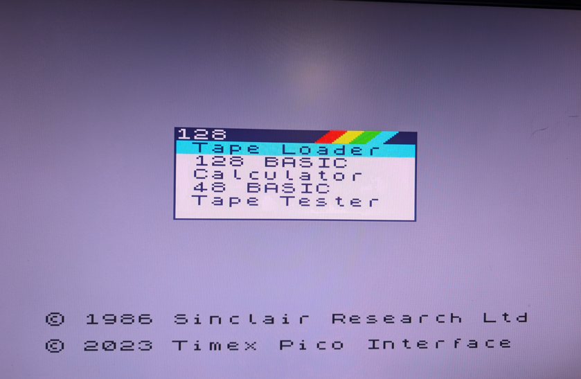

# tpzx128sd — TSPico Spectrum 128 SD

An experimental, temporary Spectrum 128 configuration for a Timex Sinclair
2068 with TSPico hardware revision V2.2 / RP2040. This version adds a cooperative legacy TSPico SD gateway.

**Current status:** The current SD BASIC ROM and no-reset SD handoff still need physical acceptance. The underlying legacy SD gateway previously passed a separate hardware diagnostic. Desktop tests are recorded for these exact artifacts; do not equate the gateway pass with a completed BASIC SAVE/LOAD hardware test.

[Temporary operation command guide](RUN-TEMPORARILY.md) ·
[Technical description](TECHNICAL.md) · [Source and rebuild instructions](BUILD.md) ·
[Exact status and hashes](STATUS.json) · [Complete package ZIP](downloads/tpzx128sd-20261027.zip)

<a href="images/tpzx128sd.png"></a>

*Screenshot of tpzx128sd running on a Timex TS2068 with TSPico. Click to view full size.*

## Hardware and protocol versions

**V2.2 is the TSPico hardware revision**, using an RP2040. It is not the
firmware or file-protocol version. The current implementation supports
**TSPico firmware/protocol v1.00**. Provision for the next protocol version
is planned through a separate backend; that support is not yet implemented
or validated. The baseline personality has no active SD service while running.

## What is included

- `sd/TAP/128/`: the matching ROM, revision-2 handoff TAP, and SD test TAP where applicable.
- `source/`: ROM patchers, Z80 source, MicroPython definitions, current USB
  helper contents, generated runtime files, models, and regression tests.
- `SHA256SUMS.json`: checksums for the unpacked publication files.

The public package is named `tpzx128sd`. Its existing helper argument remains
`zx128sd`; the actual ROM filename is `TPZXSD.ROM`.

## Temporary operation and recovery

No UF2 upgrade, Pico-file upload, replacement `main.py`, `/TS` override,
saved boot setting, or Flash programming is required. The ROM is staged in
**SRAM slot 4**, and the helper pastes Python definitions into REPL RAM.
Do not select Flash, invoke MEMBOOT, or save a new startup configuration.

Starting this mode discards the current Timex BASIC session and overwrites
the external SRAM bank regions. Save your work first. Normal TSPico cache,
logs, and explicitly saved SD files can still be written; temporary loading
does not mean zero filesystem activity.

To return, wait for any SD write to finish, stop the PC helper with Ctrl-C,
power off the Timex, and **unplug Pico USB power as well**. The next cold
boot runs the unchanged installed firmware/startup. TS Reset alone does not
clear the Pico paging latch. No return-to-Timex mode command is implemented.

## Requirements

- Traced TSPico hardware revision V2.2 board, RP2040, and the installed stock control timing;
  the corrected adapter expects the stock 270 MHz clock.
- The physically exercised runtime is MicroPython 1.20; do not change firmware
  merely to perform this trial. Other runtime/board combinations need review.
- The installed v1.00 firmware/file-protocol contract. Support for the next protocol version is planned, not yet implemented or validated.
- Desktop Python 3.10+, a USB serial cable, and exclusive access to the Pico
  COM port. Close Thonny, Tera Term, and other serial clients before the helper.

## Prepare the desktop and SD card

1. Download and extract the complete ZIP, or clone/download the repository.
   Keep this package's directory layout intact; individual helper files
   alone are insufficient.
2. Open PowerShell in this package's `source` directory and install the
   desktop serial dependency. Nothing is installed onto the Pico:

   ```powershell
   python -m pip install --target tools/serial-python -r requirements-serial.txt
   python pico_debug.py ports
   ```

   Use the reported COM port below. `COM14` is an example from the development machine.
3. Stop any old helper, power off the Timex, and unplug Pico USB.
   Copy the contents of `sd/TAP/128` to `TAP/128` on the SD card.
   Use the exact filenames shown by the stock loader; its legacy listing
   is case sensitive. Preserve existing SD files you want to keep.

## Start through the revision 2 handoff

**Experimental SD handoff:** use this procedure to evaluate the pending physical SD transition. The separate reset-held alternative below remains available.

1. Boot normal Timex/TSPico operation from the unchanged installation.
   Starting at the TAP root, enter:

   ```basic
   SAVE "tpi:cd 128"
   LOAD "tpi:TPZXSD.ROM"
   LOAD ""
   ```

   In the stock ROM installer choose **SRAM slot 4**. Do not select Flash or
   save a boot choice. Return to normal Timex BASIC without booting the new
   ROM, resetting, or power-cycling. If the installer's completion screen
   prevents this on your firmware, stop and resolve that version's return
   procedure; do not guess a MEMBOOT command. The reset-held SD alternative
   deliberately stays at the completion prompt instead.
2. Still in normal Timex BASIC and the `TAP/128` directory, load the trampoline:

   ```basic
   CLEAR 32767
   LOAD "tpi:H128SD.TAP"
   LOAD "" CODE 32768
   ```

   **Do not run USR yet.** Finish these loads before the helper interrupts
   the stock Python dispatcher.
3. Connect USB, close other serial clients, and run from `source`:

   ```powershell
   python start_handoff128.py --port COM14 --mode zx128sd
   ```

4. Keep **TS Reset released throughout** startup and all seven jobs. Press
   Enter at each desktop prompt. The helper sends the current definition
   files to interpreter RAM; it does not save them as Pico modules.
5. When the live message says `HOME handoff armed`, enter on the Timex:

   ```basic
   RANDOMIZE USR 32768
   ```

6. Expect the Spectrum 128 menu. Select **128 BASIC** (down once, Enter).
   The helper should report `ROM 0 released` and `physical_reset: False`.
   Leave the helper running: its foreground filesystem loop must continue servicing requests.

The helper validates the local ROM against the local handoff manifest, but
cannot check your earlier SD copy or installer slot selection. Copy the ROM
and TAP together from this publication. Never reuse the old revision-1 TAP.

## First checks

```basic
10 PRINT 1+2
RUN
PLAY "C"
```

Expect `3` and an audible note. Report which exact startup path and ROM hash
were used; an earlier pass does not qualify a changed build.


### SD acceptance sequence

Keep the helper running and use 128 BASIC. The included FS128.TAP contains
bytes 0 through 255. Use fresh output names to preserve existing files;
explicit SAVE has the installed firmware's ordinary overwrite behavior.

```basic
LOAD "tpi:FS128.TAP" CODE 32768
PRINT PEEK 32769
SAVE "tpi:SDCHECK" CODE 32768,256
POKE 32769,99
LOAD "tpi:SDCHECK.tap" CODE 32768
PRINT PEEK 32769
VERIFY "tpi:SDCHECK.tap" CODE 32768
```

Both PRINTs should give `1`; VERIFY should finish without error. Then try
`10 PRINT 42`, `SAVE "tpi:SDBASIC"`, delete line 10 by entering `10`,
`LOAD "tpi:SDBASIC.tap"`, and `RUN`; expect `42`.

```basic
LOAD "tpi:path"
LOAD "tpi:dir"
```

DIR uses 14 entries per page. At `scroll?`, press a key to continue, or N/Space
to cancel. Acknowledge the final `End of directory - any key` message.
Replies use the main screen and each SD session closes before the key wait.
The helper prints completed service results; it does not finish with DONE
while the foreground loop is serving BASIC.

### Alternative startup with a manually held TS Reset

This exercises the SD BASIC image with the earlier reset-held entry; physical
acceptance of the current BASIC build remains pending on this path too.
Start with a complete power cycle, boot stock firmware, and use the same ROM
mount commands to stage TPZXSD.ROM in SRAM slot 4. Leave the installer's
completion screen waiting: **do not choose restart**. Keep Timex power on.

From `source` run:

```powershell
python start_fs128_sd.py --port COM14
```

Startup and definition jobs 1–5: TS Reset released; Enter at each prompt.
For job 6 only, hold **TS Reset**, press Enter, and release immediately at the
live **ARMED** message, before waiting for completion. Do not press Pico Reset.
Select 128 BASIC and leave the helper running. Run the acceptance sequence
above. Do not mix reset instructions from this alternative with the seven-job
no-reset handoff.

`start_fs128_sd.ps1 -Port COM14` is the included PowerShell alternative to the
Python starter; use one starter, not both.

### SD limits

HOME A000-BFFF is protected service RAM and BASIC RAMTOP is 9FFFh, reducing
contiguous BASIC workspace by about 24 KiB relative to the baseline. CODE
transfers into that reservation, ROM, or wrapping past FFFFh are rejected.
C000-FFFF CODE uses the current external bank. Use 128 BASIC for acceptance;
separate 48 BASIC SD operation has not been qualified. Support for the next protocol version is planned; its handlers
are not yet supported. Do not interrupt an SD write or replay a partly completed SAVE.


## Errors and unfinished jobs

The starter refuses to replace pending/running jobs under
`source/build/serial-debug`. Preserve the result and queue files for inspection
after an error; a serial timeout does not prove a target write stopped.
Do not run USR twice, replay a running job, or reset a stalled write blindly.
After resolving unfinished writes, stop the helper and perform the complete
power-cycle recovery before a new trial. A red border after handoff means
the expected ROM fingerprint was not obtained, not a successful boot.

## Compatibility boundaries

These personalities do not provide transparent compatibility with arbitrary
Spectrum 128 games. Shadow-screen support, true fixed-bank aliases, timing,
and general software compatibility remain limited. RAM-disk paths exist,
but physical RAM-disk acceptance is still outstanding. The proposed TSPico
mode menu and mode-selection commands are not part of these packages.
See [TECHNICAL.md](TECHNICAL.md) for the mechanism and model limitations.
